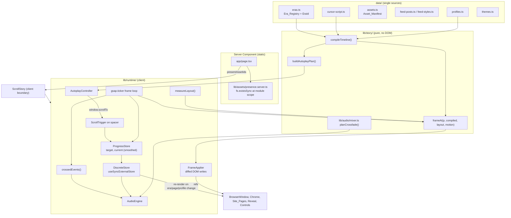

# Design Document: scroll-story-polish

## Overview

The rebuild replaces the stacked-scene approach with one architecture: a **pure Story_Timeline core** that maps a single number, Story_Progress `p ∈ [0, 1]`, to a complete `FrameState`, and a **client runtime** that reads `p` from the document scroll position once per animation frame and writes the `FrameState` to the DOM through refs. React renders the structure (OS frame, browser chrome, the three Site_Pages, reveal world, controls) and re-renders only when a small discrete snapshot changes (active Era, visible Site_Page, Browser_Profile, chrome identity, autoplay status, mute status).

Design principles:

1. **One input, one function.** Everything visible during scrolling is `frameAt(p, compiled, layout, motion)`. Autoplay moves the document scroll position; it never writes visual state directly. Scrolling backward, seeking, and autoplay therefore produce identical frames for identical `p` (Requirements 2.4, 3.5, 9.3, 11.8).
2. **One registry.** `data/eras.ts` holds every Era's order, weight, year, Site_Page, URL, title, favicon, Browser_Profile, clock text, Era_Hold, and audio bed. All other positions (Era ranges, navigation windows, cursor actions, audio events, autoplay hold points, feed section anchors) are compiled from it (Requirement 1).
3. **React owns structure; the frame applier owns motion.** Elements updated per frame expose a ref to the runtime. The runtime writes only `transform`, CSS custom properties named `--s-*`, attributes named `data-s-*`, `textContent` of elements that React renders empty, and `<input type="range">` values. JSX never sets those properties, so React reconciliation and the frame applier never fight, and the server render equals the `p = 0` frame (Requirements 2.5, 2.6, 9.4, 15.4).
4. **Deterministic rendering.** No render path reads `Date`, `Math.random`, `window`, or `matchMedia`. Random-looking layouts (rack LEDs, glitch duplicates, cursor path curvature) use a seeded PRNG (Requirement 15.5).

### Next.js 16.4.5 conventions applied

Read from `node_modules/next/dist/docs/`:

- App Router. `app/page.tsx` stays a Server Component and renders one Client Component boundary, `<ScrollStory>` (`01-getting-started/05-server-and-client-components.md`).
- `next.config.ts` has `cacheComponents: true`. The asset presence check uses `fs.existsSync` at module scope, which the caching guide (`01-getting-started/08-caching.md`, "Predictable values") lists as included in the static shell, so the page stays fully static with no `Suspense` or `'use cache'` needed. The presence module imports `'server-only'`, which Next bundles; installing the package is optional per the docs.
- `next/image` requires `width` and `height` for `/public` images that are not statically imported (`01-getting-started/12-images.md`). Images use `unoptimized` because the Browser_Window is CSS-scaled, which makes `sizes`/`srcset` selection meaningless, and period photos should stay small JPEGs. `priority` is deprecated in Next 16; above-the-fold images use `preload` or `loading="eager"` (`03-api-reference/02-components/image.md`).
- `metadata` and `viewport` are exported from `app/layout.tsx`.
- Testing uses Vitest with jsdom and React Testing Library as in `02-guides/testing/vitest.md`, plus `fast-check` for property tests.

### Key decisions and trade-offs

| Decision | Alternatives considered | Reason |
|---|---|---|
| Pure `frameAt(p)` functions + imperative frame applier on `gsap.ticker` | One master GSAP timeline scrubbed by ScrollTrigger | Pure functions are unit- and property-testable, deterministic across autoplay/manual paths, and stateful click effects revert for free. GSAP is still used for ScrollTrigger, the ticker, autoplay tweens, and the LED timeline. |
| Native document scroll with a tall spacer, read through ScrollTrigger | Virtual scroll (wheel hijack) | Keeps keyboard, touch, scrollbar, and accessibility behavior native. ScrollTrigger handles refresh on resize. |
| All three Site_Pages stay mounted; visibility toggled by the applier | Mount/unmount per Era | No React work at navigation boundaries; layout can be measured once; images preload. |
| Feed page offset is piecewise linear between measured Era section anchors | Strictly linear offset across the whole feed with section heights forced to `K × era length` | Forced heights clip or pad posts whenever the Owner changes a weight, which breaks Requirement 1.4. Piecewise linear keeps the offset proportional to progress inside each Era and aligns every Era boundary with the top of its feed section. **Review note:** this reads Requirement 2.3 as "proportional within each Era segment of a Site_Page"; single-Era pages (MySpace) are strictly linear. |
| Browser_Profile changes only where the Site_Page changes | Change browser mid-feed | Requirement 4.6 requires profile switches at a Navigation_Transition boundary and Requirement 5.1 forbids navigations inside the Continuous_Feed, so the whole feed uses one profile. **Review note:** the profile sequence is loading = XP + IE6 (2004), myspace = XP + Firefox 2 (2006), feed = macOS + Chrome (2010–2025). The feed's change over time is carried by the Facebook interface (Requirement 5.4), the clock, and the content. |
| Autoplay hold point for an Era that starts with a navigation is the end of that navigation | Hold at the exact Era start | Holding at the Era start would freeze the screen mid-URL-typing. **Review note:** Requirement 10.3's "start of an Era" is interpreted as "the point where the Era's page is fully painted". |
| One-shot sound effects fire only on forward crossings, and never during a seek | Fire in both directions | Rewinding through a click should not click. Seeking across 30 events would produce a burst of sound. |
| Howler for file beds, sharing `Howler.ctx` and `Howler.masterGain` with procedural Web Audio beds | Separate AudioContexts | One master gain gives one mute fade and one place to dispose. |

## Architecture



### Per-frame data flow

1. The Viewer scrolls (or the Autoplay_Controller calls `window.scrollTo`). ScrollTrigger's `onUpdate` calls `progressStore.setTarget(self.progress)`.
2. On each `gsap.ticker` tick, `progressStore.tick(dtMs)` moves `current` toward `target` with exponential smoothing (time constant 120 ms; 0 ms under reduced motion; snapped on seek). If `current` did not change, the tick ends.
3. `frameAt(current, compiled, layout, motion)` returns a `FrameState`.
4. `frameApplier.apply(frame)` compares each field with the last applied frame and writes only changed values.
5. `discreteStore.update(frame)` replaces its snapshot object only when a discrete field changed. React components subscribed with `useSyncExternalStore` re-render only then.
6. `crossedEvents(prevP, current, compiled.events)` returns one-shot audio events crossed forward; the AudioEngine plays them. `discreteStore` changes call `audioEngine.setBed(era.audioBed)`.

### Directory layout

Existing `components/`, `scenes/`, `data/`, and `lib/` files are deleted and replaced.

```
app/
  layout.tsx                 metadata, viewport, <html><body>
  page.tsx                   Server Component: <ScrollStory presentAssetIds={...} />
  globals.css                Tailwind v4 import, @theme tokens, data-s-* driven rules
data/
  eras.ts                    Era_Registry, EraId, STORY constants
  profiles.ts                Browser_Profiles
  themes.ts                  Site_Page themes (myspace, facebook-by-year, loading)
  assets.ts                  Asset_Manifest
  feed-posts.ts              Feed_Posts
  feed-styles.ts             Facebook interface style per Era
  myspace-profile.ts         MySpace page content
  cursor-script.ts           Cursor_Actions (Era-relative)
lib/story/                   pure modules, importable from server and client
  ranges.ts  validate.ts  compile.ts  nav.ts  page-scroll.ts  chrome-state.ts
  dial-status.ts  cursor-path.ts  cursor.ts  interactions.ts  camera.ts
  glitch.ts  frame.ts  autoplay-plan.ts  scroll-map.ts  fit.ts  events.ts  rng.ts
lib/assets/
  resolve.ts                 pure resolver
  presence.server.ts         'server-only', fs.existsSync
lib/audio/
  mixer.ts                   pure crossfade planner
  engine.ts                  'use client' AudioEngine (howler + Web Audio)
  procedural.ts              procedural beds and sfx
lib/runtime/                 'use client'
  gsap.ts                    plugin registration
  progress-store.ts  discrete-store.ts  frame-loop.ts  frame-applier.ts
  layout-measure.ts  autoplay-controller.ts  input-interrupt.ts  motion.ts
components/
  story/ScrollStory.tsx  StoryContext.tsx  BrowserWindow.tsx  Camera.tsx
        PageViewport.tsx  StoryImage.tsx  Placeholder.tsx  ScriptedCursor.tsx
  controls/ControlBar.tsx  PlayButton.tsx  MuteButton.tsx  ProgressSlider.tsx
  os/XpFrame.tsx  XpTaskbar.tsx  MacFrame.tsx  MacMenuBar.tsx
  chrome/Ie6Chrome.tsx  Firefox2Chrome.tsx  ChromeMac.tsx  cursors.tsx
  pages/LoadingPage.tsx  DialUpDialog.tsx  MySpacePage.tsx
        feed/FeedPage.tsx  FeedHeader.tsx  FeedSidebar.tsx  FeedColumn.tsx  FeedPost.tsx
  reveal/RevealWorld.tsx  DeskScene.tsx  AgentPanel.tsx  ServerRoom.tsx  useLedTimeline.ts
tests/
  properties/*.property.test.ts   unit/*.test.ts(x)
public/assets/{avatars,posts,favicons,myspace,reveal}/   public/audio/{beds,sfx}/
```

## Components and Interfaces

### 1. Era_Registry (`data/eras.ts`)

`EraId` is derived from the registry array, so it is declared exactly once (Requirement 1.3). Every other module imports `EraId` from here.

```ts
import type { ProfileId } from './profiles';
import type { AssetId } from './assets';

export type SitePageId = 'loading' | 'myspace' | 'feed';
export type BedId = 'dialup' | 'midi' | 'feed-calm' | 'feed-ads' | 'feed-noise' | 'glitch' | 'server-hum';

export interface EraDefinition {
  id: string;
  label: string;            // shown in the progress control
  weight: number;           // relative length, > 0
  year: number;
  sitePage: SitePageId | null;   // null only for reveal
  url: string;
  title: string;            // page title (tab / window title)
  favicon: AssetId;
  profile: ProfileId | null;     // null only for reveal (keeps last profile)
  clock: { time: string; date: string };  // fixed strings, SSR-safe (Req 4.8)
  holdMs: number;
  audioBed: BedId;
}

export const ERAS = [
  { id: 'loading',       label: 'Dial-up',            weight: 4,  year: 2004, sitePage: 'loading', url: '',  title: 'Connecting…', favicon: 'favicon.ie-blank', profile: 'xp-ie6',      clock: { time: '8:12 PM', date: 'Friday, October 15, 2004' }, holdMs: 0,    audioBed: 'dialup' },
  { id: 'myspace',       label: 'MySpace',            weight: 12, year: 2006, sitePage: 'myspace', url: 'http://www.myspace.com/ashley_xo16', title: "MySpace.com | ashley ♥ | 16 | Female", favicon: 'favicon.myspace', profile: 'xp-firefox2', clock: { time: '4:37 PM', date: 'Tuesday, May 9, 2006' }, holdMs: 3000, audioBed: 'midi' },
  { id: 'facebook',      label: 'Facebook',           weight: 12, year: 2010, sitePage: 'feed', url: 'http://www.facebook.com/home.php', title: 'Facebook | Home', /* … */ profile: 'mac-chrome', holdMs: 2500, audioBed: 'feed-calm' },
  { id: 'early-ads',     label: 'Early ads',          weight: 10, year: 2012, sitePage: 'feed', /* … */ holdMs: 2000, audioBed: 'feed-calm' },
  { id: 'cambridge',     label: 'Cambridge Analytica',weight: 10, year: 2016, sitePage: 'feed', /* … */ holdMs: 2500, audioBed: 'feed-ads' },
  { id: 'algo-hell',     label: 'The algorithm',      weight: 10, year: 2018, sitePage: 'feed', /* … */ holdMs: 2000, audioBed: 'feed-ads' },
  { id: 'glitch',        label: 'Glitch',             weight: 10, year: 2020, sitePage: 'feed', /* … */ holdMs: 3000, audioBed: 'glitch' },
  { id: 'ai-era',        label: 'AI content',         weight: 10, year: 2023, sitePage: 'feed', /* … */ holdMs: 2000, audioBed: 'feed-noise' },
  { id: 'dead-internet', label: 'Dead internet',      weight: 10, year: 2025, sitePage: 'feed', /* … */ holdMs: 3000, audioBed: 'feed-noise' },
  { id: 'reveal',        label: 'The reveal',         weight: 12, year: 2025, sitePage: null, profile: null, /* … */ holdMs: 0, audioBed: 'server-hum' },
] as const satisfies readonly EraDefinition[];

export type EraId = (typeof ERAS)[number]['id'];

export const STORY = {
  vhPerWeight: 12,          // spacer height = Σweight × vhPerWeight vh
  navShare: 0.25,           // navigation occupies first 25% of the incoming Era
  navTypingShare: 0.35,     // typing occupies first 35% of the navigation
  smoothingMs: 120,
  autoplaySecondsPerStory: 150,
  autoplayMinSegmentSeconds: 0.6,
  crossfadeMs: 1500,
} as const;
```

The table above is abbreviated in this document; every Era carries all fields. `validateRegistry()` (see Error Handling) runs in a unit test and at module load in development.

### 2. Browser_Profiles (`data/profiles.ts`)

```ts
export type OsId = 'winxp' | 'macos';
export type BrowserId = 'ie6' | 'firefox2' | 'chrome';
export type ProfileId = 'xp-ie6' | 'xp-firefox2' | 'mac-chrome';

export interface BrowserProfile {
  id: ProfileId;
  os: OsId;
  browser: BrowserId;
  screen: { width: number; height: number };   // design px (Req 13.1)
  controlsSide: 'left' | 'right';              // derived: winxp → right, macos → left
  hasStatusBar: boolean;
  shell: 'taskbar' | 'menubar';                // where the clock lives
  loadingIndicator: 'ie-throbber' | 'ff-throbber' | 'tab-spinner';
  cursorSet: 'xp' | 'mac';
  fonts: { ui: string };                       // e.g. 'Tahoma, "Segoe UI", Verdana, sans-serif'
  statusMessages: { resolving: string; connecting: string; transferring: string; done: string };
}

export const PROFILES: Record<ProfileId, BrowserProfile> = {
  'xp-ie6':      { os: 'winxp', browser: 'ie6',      screen: { width: 1024, height: 768 }, controlsSide: 'right', hasStatusBar: true,  shell: 'taskbar', loadingIndicator: 'ie-throbber', /* … */ },
  'xp-firefox2': { os: 'winxp', browser: 'firefox2', screen: { width: 1024, height: 768 }, controlsSide: 'right', hasStatusBar: true,  shell: 'taskbar', loadingIndicator: 'ff-throbber', /* … */ },
  'mac-chrome':  { os: 'macos', browser: 'chrome',   screen: { width: 1280, height: 800 }, controlsSide: 'left',  hasStatusBar: false, shell: 'menubar', loadingIndicator: 'tab-spinner', /* … */ },
};
```

Status messages: IE6 "Opening page http://…", "Web site found. Waiting for reply…", "Done"; Firefox 2 "Looking up www.facebook.com…", "Connecting to…", "Transferring data from…", "Done". Chrome has no status bar, so `chrome.statusText` drives the small bottom-left status bubble instead.

### 3. Timeline compiler (`lib/story/ranges.ts`, `compile.ts`)

```ts
export interface EraRange { id: EraId; index: number; start: number; end: number }

/** Contiguous ranges, start 0, end 1, length ∝ weight. */
export function computeEraRanges(weights: readonly { id: EraId; weight: number }[]): EraRange[];

/** Half-open [start, end) except the last range, which includes 1. Input is clamped to [0, 1]. Binary search. */
export function eraIndexAt(ranges: readonly EraRange[], p: number): number;

export interface NavWindow {
  from: SitePageId; to: SitePageId; toEra: EraId;
  start: number;        // = incoming Era start
  typingEnd: number;    // start + navTypingShare × navLength
  end: number;          // start + navShare × incoming Era length
}

export interface CompiledTimeline {
  ranges: EraRange[];
  navs: NavWindow[];                  // one per Site_Page change
  pageSpans: Record<SitePageId, { start: number; scrollStart: number; end: number; eras: EraId[] }>;
  actions: CompiledAction[];          // sorted by moveStart
  events: TimelineEvent[];            // one-shot audio cues, sorted by p
  holdPoints: { era: EraId; p: number; holdMs: number }[];
  spacerVh: number;
}

export function compileTimeline(eras: readonly EraDefinition[], script: readonly CursorActionDef[]): CompiledTimeline;
```

Compilation rules:

- A `NavWindow` exists at every Era boundary where `sitePage` changes between two non-reveal Eras (loading→myspace, myspace→feed). No window exists for same-page boundaries or the dead-internet→reveal boundary (Requirements 3.1, 3.6, 5.1).
- `pageSpans[page].scrollStart` is the end of the navigation into that page (or the page start if none). The page offset is 0 before `scrollStart`.
- Every Era-relative value (`CursorActionDef.at`, durations) becomes absolute as `range.start + rel × (range.end − range.start)` (Requirement 1.4).
- For each `NavWindow`, the compiler inserts a cursor click on `chrome.address` at `nav.start` and a `nav-start` audio event at `nav.typingEnd` (the "Enter" moment).
- Each click action contributes a `mouse-click` event at its `pressStart`.
- `holdPoints[era].p` is the Era start, or `nav.end` for Eras that begin with a navigation.

### 4. Navigation, chrome, and loading scene (`nav.ts`, `chrome-state.ts`, `dial-status.ts`)

```ts
export type NavPhase = 'typing' | 'loading';
export type PaintStage = 0 | 1 | 2 | 3 | 4 | 5;   // blank, header, layout, text, images, done

export interface NavState { window: NavWindow; t: number; phase: NavPhase; stage: PaintStage }

export function navStateAt(navs: readonly NavWindow[], p: number): NavState | null;

/** Loading-phase local u ∈ [0,1] → stage. Thresholds: 0.15, 0.35, 0.55, 0.75, 0.95. Monotonic. */
export function paintStageAt(u: number): PaintStage;

export interface ChromeState {
  addressText: string;     // typed prefix during typing, full URL otherwise
  caretVisible: boolean;   // address-bar caret during typing
  loading: boolean;        // throbber / spinner on during loading phase
  loadProgress: number;    // 0..1, drives IE6/Firefox status bar progress segments
  statusText: string;      // '' when idle; "Done" briefly after load
}
export function chromeStateAt(c: CompiledTimeline, p: number): ChromeState;

/** Title and favicon: outgoing Era's until the navigation finishes, then the active Era's. Discrete. */
export function chromeIdentityAt(c: CompiledTimeline, p: number): { title: string; favicon: AssetId };

export type DialStatus = 'dialing' | 'verifying' | 'registering' | 'connected';
/** Loading-Era local t → status. Thresholds 0.30, 0.55, 0.80. Monotonic. */
export function dialStatusAt(t: number): DialStatus;
```

Typing reveals `ceil(url.length × (p − start) / (typingEnd − start))` characters. With `navShare = 0.25` and `navTypingShare = 0.35`, typing spans 8.75% of the incoming Era, above the 3% minimum (Requirement 3.7). `validateRegistry` rejects constant values that would bring it below 3%.

Progressive paint (Requirement 3.3): Site_Page elements carry a static `data-paint="header|layout|text|images"` attribute in JSX. The applier sets `data-s-stage="0..5"` on the incoming page root. CSS in `globals.css`:

```css
[data-s-stage="0"] [data-paint] { visibility: hidden; }
[data-s-stage="1"] [data-paint]:not([data-paint="header"]) { visibility: hidden; }
[data-s-stage="2"] [data-paint="text"], [data-s-stage="2"] [data-paint="images"] { visibility: hidden; }
[data-s-stage="3"] [data-paint="images"] { visibility: hidden; }
[data-s-stage="4"] [data-paint="images"] { clip-path: inset(0 0 var(--s-img-reveal, 100%) 0); } /* top-down image paint */
```

The Browser_Profile switches to the incoming Era's profile at `nav.start`, the first point of the Navigation_Transition (Requirement 4.6): the new browser window appears with the outgoing page still in it and the URL is typed into its address bar. During the typing phase the outgoing page stays visible. At `typingEnd` the outgoing page hides and the incoming page shows at stage 0. Because every value is a function of `p`, scrolling backward plays these steps in reverse (Requirement 3.5).

The Loading_Scene (`LoadingPage` + `DialUpDialog`) renders an IE6 window showing a blank page and a Windows XP "Connect Dial-up Connection" dialog with modem icon, all four status lines in JSX, and CSS showing only the one matching `data-s-dial` (Requirements 8.1, 8.2). With no attribute (server render) the "Dialing…" line shows.

### 5. Page scrolling (`page-scroll.ts`)

```ts
export interface PageLayout {
  contentHeight: number;      // design px
  viewportHeight: number;     // Page_Viewport height for the page's profile, design px
  sectionTops: Partial<Record<EraId, number>>;  // measured [data-era-section] tops; MySpace/loading: none
}

/** Anchors A_0..A_n: A_i = clamp(sectionTop(era_i)) (A_0 = 0), A_n = max(0, contentHeight − viewportHeight); forced non-decreasing. */
export function pageAnchors(span: PageSpan, layout: PageLayout): number[];

/** Offset in design px. 0 before scrollStart. Within era i: lerp(A_i, A_{i+1}, u), u = local progress after scrollStart. Clamped to [0, maxOffset]. */
export function pageOffsetAt(span: PageSpan, anchors: readonly number[], p: number, ranges: readonly EraRange[]): number;
```

The applier writes `transform: translate3d(0, -${offset}px, 0)` to the page's scroll content element. For the reveal Era, the feed keeps its final offset (the screen is frozen as the camera pulls back). The feed column ends with a trailing "loading more stories" block at least one viewport tall, so the final frame never shows empty space.

### 6. Feed structure and styles (`FeedPage`, `data/feed-styles.ts`)

`FeedPage` has a fixed part inside the Page_Viewport (`FeedHeader`, `FeedSidebar`) and a scrolled `FeedColumn`. `FeedColumn` renders one `<section data-era-section={era}>` per feed Era in Era_Registry order, each containing that Era's posts from `orderFeed(FEED_POSTS)` (Requirement 5.2).

```ts
export interface FeedStyle {
  header: 'fb-2010' | 'fb-2014' | 'fb-2019';
  sidebar: 'fb-2010' | 'fb-2016' | 'fb-2020';
  postLayout: 'fb-2010' | 'fb-2012' | 'fb-2023';
  reactions: 'like-text' | 'reactions-2016' | 'reactions-glitched';
}
export const FEED_STYLES: Record<FeedEraId, FeedStyle>;
```

Planned changes, at most one element per boundary (Requirement 5.4):

| Era (year) | header | sidebar | postLayout | reactions | changed |
|---|---|---|---|---|---|
| facebook (2010) | fb-2010 | fb-2010 | fb-2010 | like-text | — |
| early-ads (2012) | fb-2010 | fb-2010 | fb-2012 | like-text | postLayout |
| cambridge (2016) | fb-2010 | fb-2010 | fb-2012 | reactions-2016 | reactions |
| algo-hell (2018) | fb-2014 | fb-2010 | fb-2012 | reactions-2016 | header |
| glitch (2020) | fb-2014 | fb-2020 | fb-2012 | reactions-2016 | sidebar |
| ai-era (2023) | fb-2014 | fb-2020 | fb-2023 | reactions-2016 | postLayout |
| dead-internet (2025) | fb-2014 | fb-2020 | fb-2023 | reactions-glitched | reactions |

Header and sidebar styles come from the active Era (discrete re-render). Post layout and reactions are rendered per section, so posts on either side of a boundary keep their own style and the change scrolls into view gradually.

Feed composition (Requirement 5.3): six posts per feed Era, of which `k` are ad, sponsored, or bot posts, where `k` is the Era's index in the feed (0 to 6). The non-organic share is 0, 1/6, 2/6, 3/6, 4/6, 5/6, 1. In dead-internet every author has `isBot: true` (Requirement 5.5). Glitch posts include duplicated body text across two authors, one avatar asset reused under three different names, and a name that differs between the post header and its comment (Requirement 5.6). Glitch distortion uses `glitchFxAt(eraT, reduced)` written to `--s-glitch-shift`, `--s-glitch-skew`, `--s-glitch-flicker`.

### 7. Themes (`data/themes.ts`)

One theme object per Site_Page style, applied as CSS custom properties on the page root in JSX (static, SSR-safe) and consumed with Tailwind v4 arbitrary values such as `text-(--t-body-size)`.

```ts
export interface SiteTheme {
  id: 'loading-xp' | 'myspace-2006' | 'facebook-2010' | 'facebook-2014' | 'facebook-2019';
  fonts: { body: string; heading: string };   // each stack ends with a generic family
  sizes: { body: string; small: string; heading: string };
  colors: Record<'bg' | 'text' | 'link' | 'header' | 'border' | 'muted', string>;
  spacing: Record<'gutter' | 'post' | 'radius', string>;
}
// myspace-2006: body 'Verdana, Tahoma, "DejaVu Sans", Geneva, sans-serif', 10px, link #003399, header #003399/#6699CC
// facebook-2010: body '"Lucida Grande", Tahoma, Verdana, Arial, sans-serif', 11px, header #3B5998
```

All Site_Page text is HTML text (Requirement 6.4). Fallbacks come from the stack (Requirement 6.5). The MySpace page renders the 2006 header with search bar and nav links, profile photo, "Details" and "Interests" tables, "ashley's Friend Space" Top 8 grid, and a "Friends Comments" table (Requirement 6.1).

### 8. Asset_Manifest and images (`data/assets.ts`, `lib/assets/*`, `StoryImage`)

```ts
export type AssetKind = 'avatar' | 'post-image' | 'favicon' | 'profile-photo' | 'reveal' | 'audio-bed' | 'audio-sfx';

export interface AssetDescription {
  subject: string;       // "teenage girl with side-swept bangs, peace sign"
  apparentAge: string;   // "16" | "n/a"
  setting: string;       // "bedroom mirror, flash"
  photoStyle: string;    // "2006 point-and-shoot, high-angle selfie, slight noise"
}

export interface AssetEntry {
  id: string;
  kind: AssetKind;
  path: `/${string}`;    // under /public, e.g. '/assets/avatars/ashley.jpg'
  era: EraId | 'shared';
  description: AssetDescription;
  alt: string;           // short alt text derived from the description
  width: number;         // px; audio: 0
  height: number;
  approved: boolean;
}

export const ASSETS = [ /* every entry */ ] as const satisfies readonly AssetEntry[];
export type AssetId = (typeof ASSETS)[number]['id'];
```

Presence (server only):

```ts
// lib/assets/presence.server.ts
import 'server-only';
import { existsSync } from 'node:fs';
import { join } from 'node:path';
import { ASSETS } from '@/data/assets';

export const PRESENT_ASSET_IDS: readonly string[] =
  ASSETS.filter((a) => existsSync(join(process.cwd(), 'public', a.path))).map((a) => a.id);
```

Resolver (pure, shared):

```ts
export type ResolvedAsset =
  | { kind: 'image'; src: string; width: number; height: number; alt: string }
  | { kind: 'placeholder'; variant: 'avatar' | 'box'; label: string; width: number; height: number; alt: string };

export function resolveAsset(entry: AssetEntry, present: ReadonlySet<string>): ResolvedAsset;
```

`StoryImage({ id, eager? })` reads the present set from `AssetContext` and renders either `next/image` (`unoptimized`, explicit `width`/`height`, `style={{ width, height }}`, `alt`) or `<Placeholder>`: a `role="img"` element with `aria-label={alt}` and identical width and height. Avatar placeholders show a grey silhouette; others show a labelled box with the asset id and dimensions. `onError` on the real image swaps to the placeholder (covers a deleted file during `next dev`). After the Owner adds a file and flips `approved: true`, the next build includes it (Requirement 7.7).

### 9. Scripted cursor (`data/cursor-script.ts`, `cursor-path.ts`, `cursor.ts`, `interactions.ts`)

```ts
export type TargetName = string;  // e.g. 'feed.post.fb-03.like', 'chrome.address', 'myspace.comment.box'
export type TargetKind = 'link' | 'button' | 'text-field' | 'plain';

export type CursorEffect =
  | { kind: 'set'; target: TargetName; flag: 'liked' | 'focused' | 'posted' | 'expanded' };

export interface CursorActionDef {
  id: string;
  era: EraId;
  at: number;              // Era-relative arrival time, 0..1
  kind: 'move' | 'hover' | 'click' | 'type';
  target: TargetName;
  moveDuration?: number;   // Era-relative, default 0.06
  dwell?: number;          // hover before press, default 0.02
  text?: string;           // type only
  typeDuration?: number;   // Era-relative, default scales with text length
  effects?: CursorEffect[];
}

export interface CompiledAction {
  id: string; kind: CursorActionDef['kind']; target: TargetName;
  moveStart: number; arrive: number; pressStart: number; pressEnd: number; end: number;
  text?: string; effects: CursorEffect[]; seed: number;
}
```

Targets are marked in JSX with `data-cursor-target="name"` and `data-cursor-kind="link|button|text-field|plain"`.

**Path** (`cursor-path.ts`, Requirement 11.2): from `P0` to `P1`, a quadratic Bézier with control point `C = mid(P0, P1) + n̂ × d × k`, where `n̂` is the unit normal, `d = |P1 − P0|`, and `k ∈ [0.12, 0.28] × (±1)` comes from `rng(action.seed)`. Time is eased with the minimum-jerk profile `s(t) = 10t³ − 15t⁴ + 6t⁵` (zero velocity and acceleration at both ends). When `P0 = P1` the path is the constant point.

```ts
export function minimumJerk(t: number): number;
export function cursorPathPoint(p0: Vec2, p1: Vec2, seed: number, t: number): Vec2;
```

**Target resolution** (Requirement 11.3):

```ts
export interface TargetLayout {
  space: 'page' | 'chrome';
  page?: SitePageId;
  x: number; y: number; w: number; h: number;  // design px; page targets relative to page content, chrome targets relative to Browser_Window
  kind: TargetKind;
}
/** Center of target in Browser_Window design coordinates at progress p. Page targets: viewportOrigin + (x + w/2, y + h/2 − pageOffsetAt(page, p)). */
export function resolveTarget(layout: LayoutSnapshot, name: TargetName, p: number, c: CompiledTimeline): Vec2 | null;
```

**Cursor state:**

```ts
export type PointerShape = 'arrow' | 'hand' | 'ibeam' | 'busy';
export interface CursorState { x: number; y: number; pointer: PointerShape; pressed: boolean }
export function cursorAt(c: CompiledTimeline, layout: LayoutSnapshot, p: number): CursorState;
```

Before the first action the cursor rests at a fixed point. During `[moveStart, arrive)` it follows the curved path from the previous target's resolved position at `p` to the current target's resolved position at `p`, so a scrolling target is tracked continuously. After arrival it stays on the target. Pointer shape: `hand` while hovering or pressing a `link`/`button`; `ibeam` on a `text-field`; `busy` (arrow with hourglass) during a navigation's loading phase on Windows profiles; otherwise `arrow`. Sprites come from `chrome/cursors.tsx` per `cursorSet` (Requirement 11.4).

**Interaction state** (Requirements 11.4–11.7):

```ts
export interface InteractionState {
  hovered: TargetName | null;
  pressed: TargetName | null;
  flags: Readonly<Record<TargetName, readonly CursorEffect['flag'][]>>;
  typed: Readonly<Record<TargetName, string>>;
  focused: TargetName | null;
}
/** Pure fold over actions with moveStart ≤ p. */
export function interactionStateAt(actions: readonly CompiledAction[], p: number): InteractionState;
```

Windows for a click: hover in `[arrive, pressStart)`, pressed in `[pressStart, pressEnd)`, effects applied for `p ≥ pressEnd`. For a type action on a text field: focused from `arrive`, `typed[target] = text.slice(0, n)` where `n = ceil(text.length × (p − pressEnd) / (end − pressEnd))` clamped to `[0, text.length]`.

The applier writes `data-s-cursor="hover|pressed"`, `data-s-liked`, `data-s-focused`, `data-s-posted` to target elements and the typed string into an empty `<span data-s-typed>` inside the comment box, followed by a caret `<span>` that blinks with a CSS animation. Like counts are rendered by React as two static spans (base and incremented); CSS shows the incremented one when `[data-s-liked]` is set. This keeps React-rendered text untouched by the applier.

The cursor element is a child of the Browser_Window inside the `Camera` element, so it scales with the reveal zoom (Requirement 11.9).

### 10. Reveal_Scene (`camera.ts`, `components/reveal/*`)

World layout, in Browser_Window design px with the main monitor screen at `(0, 0, W, H)` (the Browser_Window itself):

- `DeskScene`: monitor bezel and stand around the Browser_Window, a second monitor to the right showing `AgentPanel`, a Mac mini on the desk, keyboard and mouse.
- `AgentPanel`: a terminal-style log generated from `compiled.actions` (for example `> click("Like", post #fb-03)`, `> type(comment, "lol same")`) and a status header "agent: browsing-session-7 · running". The lines are static text derived from the script.
- `ServerRoom`: an SVG with a `viewBox`, rows of racks laid out by `mulberry32(REVEAL_SEED)`, with the desk-and-Mac-mini unit placed on a rack shelf as one machine among many Mac minis. Rack LEDs are `<circle>` elements.

```ts
export interface CameraKey { t: number; scale: number; focus: Vec2 }   // focus in world coords
export const CAMERA_KEYS: readonly CameraKey[] = [
  { t: 0.00, scale: 1,     focus: screenCenter },
  { t: 0.40, scale: 0.32,  focus: deskCenter },     // Mac mini + agent monitor (Req 9.1)
  { t: 0.55, scale: 0.32,  focus: deskCenter },     // short hold
  { t: 0.90, scale: 0.035, focus: roomCenter },     // server room (Req 9.2)
  { t: 1.00, scale: 0.035, focus: roomCenter },     // final hold (Req 9.6)
];

export interface CameraState { scale: number; tx: number; ty: number; worldOpacity: number; fadeToBlack: number }
/** Interpolates log(scale) and focus with power2.inOut easing per segment. Reduced motion: scale/focus jump to the nearest keyframe at segment midpoints; fadeToBlack dips 0→1→0 around each jump. */
export function cameraAt(t: number, reduced: boolean): CameraState;
```

The applier writes `transform: translate(tx, ty) scale(scale)` to the `Camera` element, which contains both the Browser_Window and the reveal world, plus `--s-world-opacity` (the world fades in over the first 5% of the reveal so letterbox areas do not pop) and `--s-fade` on a black overlay. `will-change: transform` is set on the camera element only while the reveal is active.

**LEDs** (Requirement 9.5): `useLedTimeline(containerRef, active)` uses `useGSAP` to build one `gsap.timeline({ repeat: -1, paused: true })` that adds a short opacity blink per LED at offsets from `mulberry32(LED_SEED)`. It plays only while the reveal Era is active and is reverted by `useGSAP` cleanup. No `setInterval` is used.

All reveal markup is a function of constants and the compiled script, so server and first client render match (Requirement 9.4).

### 11. Autoplay (`autoplay-plan.ts`, `autoplay-controller.ts`, `input-interrupt.ts`)

```ts
export type PlanStep = { kind: 'travel'; from: number; to: number; seconds: number } | { kind: 'hold'; era: EraId; ms: number };

/** From p0: for each hold point h with h.p > p0 + ε: travel(prev → h.p), hold(h.holdMs); finally travel(prev → 1). Empty when p0 ≥ 1 − ε. */
export function buildAutoplayPlan(c: CompiledTimeline, p0: number): PlanStep[];

export interface AutoplayController {
  readonly status: 'stopped' | 'playing';
  play(): void;        // builds plan from current target progress; no-op at 1
  stop(): void;        // kills timeline, leaves scroll where it is
  toggle(): void;
  subscribe(fn: () => void): () => void;
  dispose(): void;
}
```

`play()` converts the plan into one `gsap.timeline` of `to(proxy, { p, duration, ease: 'power2.inOut' })` steps and empty `to({}, { duration: ms / 1000 })` holds. Travel duration is `max(autoplayMinSegmentSeconds, Δp × autoplaySecondsPerStory)`. `onUpdate` calls `window.scrollTo({ top: progressToScroll(proxy.p), behavior: 'instant' })`. Easing in and out of each segment gives acceleration and deceleration around every hold (Requirement 10.2). `onComplete` sets status `stopped` (Requirement 10.6).

`input-interrupt.ts` listens on `window` for `wheel`, `touchstart`, and `keydown` with ArrowUp, ArrowDown, PageUp, PageDown, Home, End (passive where possible) and calls `stop()` (Requirement 10.4). A `keydown` Space handler toggles autoplay and calls `preventDefault()` unless the event target is an `input`, `textarea`, `select`, `button`, or `contenteditable` element (Requirement 14.4; skipping buttons avoids a double toggle when the play button has focus).

Under reduced motion, autoplay is available and starts only on Viewer action (Requirement 14.2); there is no auto-start in any mode.

### 12. Scroll mapping and viewport fit (`scroll-map.ts`, `fit.ts`)

```ts
export function progressToScroll(p: number, maxScroll: number): number;   // clamp(p) × maxScroll
export function scrollToProgress(y: number, maxScroll: number): number;   // maxScroll ≤ 0 → 0

export interface Fit { scale: number; x: number; y: number }
/** Uniform scale fitting design (w,h) into available area (vw, vh − controlBarHeight); centered. */
export function fitScale(vw: number, vh: number, design: { width: number; height: number }, reservedBottom: number): Fit;
```

On `resize` (and via ScrollTrigger's `refreshInit`/`refresh` events) the runtime saves `progressStore.target`, lets ScrollTrigger recompute, then restores the scroll position with `progressToScroll(saved, newMax)` and re-measures layout (Requirement 13.3). The fit is written as `--s-fit-scale`, `--s-fit-x`, `--s-fit-y` on the stage root. The fit is also recomputed when the discrete Browser_Profile changes, because the XP profiles use a 1024×768 design size and `mac-chrome` uses 1280×800. The stage is `visibility: hidden` until the first frame sets `data-s-ready`, which avoids a flash of an unscaled 1024 px window before hydration.

### 13. Audio (`lib/audio/*`)

```ts
// mixer.ts (pure)
export interface ActiveBed { id: BedId; targetGain: 0 | 1; requestedAt: number }
export interface MixPlan { beds: ActiveBed[]; stop: BedId[]; fadeMs: number }
/** At most two beds. Same bed as current → no change. Third bed request → stop the oldest fading-out bed immediately. Latest target gets gain 1, others 0. */
export function planCrossfade(active: readonly ActiveBed[], target: BedId, now: number, crossfadeMs: number): MixPlan;

// engine.ts ('use client')
export interface AudioEngine {
  readonly muted: boolean;
  setMuted(muted: boolean): void;  // unmute: resume Howler.ctx, start active bed, fade in 500 ms; mute: master → 0 over 200 ms, then pause beds
  setBed(bed: BedId): void;        // applies planCrossfade with crossfadeMs = 1500
  playSfx(id: 'nav-start' | 'mouse-click'): void;   // ignored while muted
  dispose(): void;                 // stop all sources, clear the single scheduler timer, unload Howls
}
export function createAudioEngine(present: ReadonlySet<string>): AudioEngine;
```

Bed sources implement `{ start(dest: AudioNode): void; fade(to: number, ms: number): void; stop(): void }`. `selectBedSource(bed, present)` returns a `FileBed` (Howler `Howl`, `loop: true`) when the manifest entry `audio.bed.<id>` is present, otherwise a `ProceduralBed` (Requirements 12.8, 12.9). Procedural beds: `dialup` (modem handshake tones), `midi` (square-wave melody), `feed-calm` (soft room tone with a notification blip), `feed-ads` and `feed-noise` (band-passed noise at rising levels), `glitch` (noise plus seeded static bursts), `server-hum` (60/120 Hz filtered sawtooth plus fan noise). Procedural beds that sequence notes share one engine-owned look-ahead scheduler (`setInterval` 100 ms) that `dispose()` clears (Requirement 12.10). Procedural sources connect to `Howler.masterGain` so one master fade covers both kinds. A Howl `onloaderror` replaces that bed with its procedural fallback.

### 14. Runtime stores and frame applier (`lib/runtime/*`)

```ts
export interface ProgressStore {
  readonly target: number; readonly current: number;
  setTarget(p: number): void;
  jump(p: number): void;          // seek: current = target = p, marks next tick as seek
  tick(dtMs: number, smoothingMs: number): { changed: boolean; prev: number; seek: boolean };
}

export interface DiscreteSnapshot {
  era: EraId; visiblePage: SitePageId; profile: ProfileId;
  identity: { title: string; favicon: AssetId };
  reduced: boolean;
}
export interface DiscreteStore {
  getSnapshot(): DiscreteSnapshot;
  getServerSnapshot(): DiscreteSnapshot;   // the p = 0 snapshot
  subscribe(fn: () => void): () => void;
  update(frame: FrameState, reduced: boolean): void;   // replaces snapshot only on change
}

export interface FrameApplier { apply(frame: FrameState): void; reset(): void }
export function createFrameApplier(sink: DomSink): FrameApplier;
```

`DomSink` is a small interface (`setTransform`, `setVar`, `setAttr`, `setText`, `setValue`) over bound elements. Production uses refs registered through `runtime.bind(key)`, a React 19 ref callback that returns a cleanup function. Tests use an in-memory sink. Autoplay and mute status live in their own tiny stores consumed with `useSyncExternalStore`.

`ScrollStory` creates the runtime inside `useGSAP(() => …, { scope: rootRef })`: it registers plugins, creates the ScrollTrigger on the spacer, adds the ticker callback, attaches interrupt and resize listeners, starts `measureLayout` (also after `document.fonts.ready` and after each discrete re-render via `useLayoutEffect`), and returns cleanup that kills the trigger, removes the ticker callback and listeners, disposes autoplay and audio (Requirement 15.6).

### 15. Controls (`components/controls/*`)

- `PlayButton`: `<button aria-label="Play story" | "Pause story" aria-pressed>`.
- `MuteButton`: `<button aria-label="Unmute sound" | "Mute sound" aria-pressed>`; initial state muted (Requirement 12.1).
- `ProgressSlider`: native `<input type="range" min=0 max=1000 step=1 aria-label="Story progress">`. The applier writes `value`, `--s-progress` (fill width), and `aria-valuetext` ("MySpace, 2006, 14%"). The visible Era label next to it re-renders on Era change. `input` events call `autoplay.stop()`, `progressStore.jump(p)`, and `window.scrollTo` (Requirement 10.8). Keyboard arrows work natively (Requirement 14.3); the slider stops arrow-key propagation so it does not double as a page scroll.

## Data Models

```ts
// data/feed-posts.ts
export type FeedEraId = Extract<EraId, 'facebook' | 'early-ads' | 'cambridge' | 'algo-hell' | 'glitch' | 'ai-era' | 'dead-internet'>;
export type PostKind = 'status' | 'photo' | 'link' | 'ad' | 'sponsored' | 'bot';

export interface FeedAuthor { id: string; name: string; avatar: AssetId; isBot: boolean }
export interface FeedComment { author: FeedAuthor; text: string; timestampText: string }

export interface FeedPost {
  id: string;
  era: FeedEraId;
  kind: PostKind;
  author: FeedAuthor;
  timestampText: string;      // "about 2 hours ago" — fixed text, never computed from Date
  body: string;
  image?: AssetId;
  reactions: { likes: number; comments: number; shares: number; breakdown?: Partial<Record<'like' | 'love' | 'haha' | 'wow' | 'sad' | 'angry', number>> };
  comments: FeedComment[];
}

export const FEED_POSTS: readonly FeedPost[];
export function orderFeed(posts: readonly FeedPost[]): FeedPost[];   // stable sort by Era_Registry order
export function nonOrganicShare(posts: readonly FeedPost[], era: FeedEraId): number;

// lib/story/frame.ts
export interface FrameState {
  p: number;
  era: EraId; eraT: number;
  visiblePage: SitePageId;        // during reveal: 'feed'
  pageStage: Partial<Record<SitePageId, PaintStage>>;
  pageOffset: Record<SitePageId, number>;
  nav: NavState | null;
  chrome: ChromeState;
  identity: { title: string; favicon: AssetId };
  profile: ProfileId;
  dial: DialStatus;
  cursor: CursorState;
  interactions: InteractionState;
  glitch: { shift: number; skew: number; flicker: number };
  camera: CameraState;
}

export interface LayoutSnapshot {
  pages: Record<SitePageId, PageLayout>;
  targets: Record<TargetName, TargetLayout>;
  viewportOrigin: Record<ProfileId, Vec2>;   // Page_Viewport top-left inside Browser_Window
}

export function frameAt(c: CompiledTimeline, layout: LayoutSnapshot, p: number, motion: { reduced: boolean }): FrameState;

// lib/story/rng.ts
export function mulberry32(seed: number): () => number;   // deterministic [0, 1)
export function seededPick<T>(seed: number, items: readonly T[]): T;

// lib/story/events.ts
export interface TimelineEvent { p: number; id: 'nav-start' | 'mouse-click'; sourceId: string }
/** Events with prev < e.p ≤ next when next > prev; empty otherwise. */
export function crossedEvents(events: readonly TimelineEvent[], prev: number, next: number): TimelineEvent[];
```

Asset path conventions: `/assets/avatars/<author-id>.jpg` (48×48 for 2010-era feed, 40×40 later; MySpace Top 8 at 90×90), `/assets/posts/<post-id>.jpg` (period sizes, for example 398×299 for 2010 photo posts), `/assets/favicons/<site>.png` (16×16), `/assets/myspace/profile.jpg` (170×213), `/assets/reveal/wallpaper.jpg` (1280×800), `/audio/beds/<bed>.mp3`, `/audio/sfx/<id>.mp3`.

## Error Handling

| Condition | Handling |
|---|---|
| Registry invalid: non-positive weight, missing field, duplicate id, profile change without Site_Page change, reveal not last, URL typing span below 3% | `validateRegistry()` returns a list of errors. A unit test asserts the list is empty, so `npm test` fails. In development it throws at module load; in production it logs once and continues with the data. |
| Cursor script invalid: unknown Era, overlapping windows, `at` outside 0–1 | `compileTimeline` collects errors the same way; overlapping actions are shifted forward in production. |
| Cursor target not found in the DOM | `resolveTarget` returns `null`; the cursor holds its last resolved position and a development-only `console.warn` names the target once. |
| Layout not yet measured (server render, first client frame) | Default `LayoutSnapshot` has zero anchors, so offsets are 0, matching the server markup. |
| Fonts load after measurement | `document.fonts.ready` triggers re-measure. |
| Asset unapproved or missing at build | Placeholder with the manifest's width, height, and alt. |
| Image fails to load at runtime | `onError` swaps to the placeholder; no layout shift because dimensions are fixed. |
| AudioContext blocked or `resume()` rejects | Engine stays muted; mute button keeps the muted state. |
| Audio file fails to load | That bed switches to its procedural fallback. |
| Progress outside [0, 1] or `NaN` from ScrollTrigger | All pure functions clamp; `NaN` is treated as the previous value. |
| Viewport smaller than 360 px or larger than 2560 px | `fitScale` still returns a valid uniform scale; behavior is only guaranteed in range. |
| Seek across many events | `progressStore.jump` marks the tick as a seek; `crossedEvents` results are discarded for that tick, and the bed changes once to the final Era. |
| Unmount (Fast Refresh, route change) | `useGSAP` cleanup kills ScrollTrigger, ticker callback, LED timeline, and autoplay timeline; listeners are removed; `audioEngine.dispose()` stops sources and clears its timer. |

## Correctness Properties

*A property is a characteristic or behavior that should hold true across all valid executions of a system-essentially, a formal statement about what the system should do. Properties serve as the bridge between human-readable specifications and machine-verifiable correctness guarantees.*

### Property 1: Era ranges partition the story

*For any* list of Eras with positive weights, `computeEraRanges` returns contiguous ranges that start at 0, end at 1, have lengths equal to `weight / Σweight`, and *for any* `p` in [0, 1], `eraIndexAt` returns exactly the one range that contains `p` (half-open, with the last range closed at 1).

**Validates: Requirements 1.2, 1.5**

### Property 2: Compiled positions follow Era-relative definitions

*For any* positive weights assigned to the registry Eras and any valid cursor script, every compiled cursor action time, navigation window, audio event, and autoplay hold point equals `start + rel × length` of its owning Era's range for its Era-relative definition, and lies inside that range.

**Validates: Requirements 1.4**

### Property 3: Navigations and profile changes occur only at Site_Page changes

*For any* generated registry, `compileTimeline` produces a navigation window at a boundary if and only if the Site_Page differs across that boundary (excluding the reveal boundary), and `validateRegistry` reports an error if and only if some consecutive pair of Eras changes Browser_Profile without changing Site_Page.

**Validates: Requirements 3.1, 3.6, 4.6, 5.1**

### Property 4: Page offset is monotonic and linear within an Era

*For any* page layout and timeline, `pageOffsetAt` is 0 before the page's scroll start, non-decreasing in `p`, bounded by `[0, contentHeight − viewportHeight]`, equal to the Era's section anchor at each Era start after the scroll start, and linear in `p` within each Era segment.

**Validates: Requirements 2.2, 2.3**

### Property 5: Frame state depends only on progress

*For any* sequence of progress values ending at `p` (including sequences that go backward past clicks, typing, and navigations), applying the frames of the sequence in order through the frame applier to an in-memory sink yields the same sink contents as applying `frameAt(p)` once to a fresh sink.

**Validates: Requirements 2.4, 3.5, 9.3, 11.1, 11.7, 11.8**

### Property 6: Discrete snapshot changes only on discrete changes

*For any* sequence of progress values, the number of times the discrete store replaces its snapshot equals the number of consecutive pairs whose Era, visible Site_Page, Browser_Profile, or chrome identity differ, and the snapshot object identity is unchanged otherwise.

**Validates: Requirements 2.5, 2.6**

### Property 7: Exactly one Site_Page is visible outside navigation

*For any* timeline and any `p` outside a navigation window, exactly one Site_Page is visible in the frame, and during the reveal Era it is the feed.

**Validates: Requirements 2.8**

### Property 8: Chrome state during and after navigation

*For any* timeline and `p`: inside a navigation's typing phase the address text is a prefix of the incoming URL whose length is non-decreasing in `p` and reaches the full URL at the typing end, and the typing span is at least 3% of the incoming Era's range; inside the loading phase the loading indicator is on and the status text is non-empty when the profile has a status bar; outside navigation the address text, title, and favicon equal the registry values of the active Era.

**Validates: Requirements 3.2, 3.4, 3.6, 3.7**

### Property 9: Staged progress functions are monotonic

*For any* `u1 ≤ u2` in [0, 1], `paintStageAt(u1) ≤ paintStageAt(u2)` and `dialStatusAt(u1)` is not later than `dialStatusAt(u2)` in the order dialing, verifying, registering, connected; `paintStageAt(0)` is blank, `paintStageAt(1)` is done, `dialStatusAt(0)` is dialing, and `dialStatusAt(1)` is connected.

**Validates: Requirements 3.3, 8.2**

### Property 10: Feed ordering follows Era order

*For any* list of feed posts, `orderFeed` returns a permutation of the input in which Era indices are non-decreasing and posts within the same Era keep their input order.

**Validates: Requirements 5.2**

### Property 11: Asset resolution

*For any* manifest entry and any set of present asset ids, `resolveAsset` returns an image if and only if the entry is approved and present; otherwise a placeholder; and in both cases the result's width, height, and alt equal the entry's width, height, and alt.

**Validates: Requirements 7.3, 7.4, 7.5, 7.7**

### Property 12: Camera and motion effects

*For any* `t1 ≤ t2` in the reveal Era, `cameraAt(t1).scale ≥ cameraAt(t2).scale`, `cameraAt` is continuous in full-motion mode, and `cameraAt(t)` is constant for `t` in the final hold segment; *for any* `t` under reduced motion, the camera scale takes only keyframe values and `glitchFxAt` returns zero shift and zero skew, so only opacity varies.

**Validates: Requirements 9.2, 9.3, 9.6, 14.1**

### Property 13: Autoplay plan is continuous and holds at every Era ahead

*For any* timeline and starting progress `p0`, `buildAutoplayPlan` produces travel steps whose first `from` equals `p0`, each `from` equals the previous `to`, targets are non-decreasing, the last `to` equals 1 (or the plan is empty when `p0` is 1), and a hold of exactly `holdMs` follows each hold point greater than `p0`, in order.

**Validates: Requirements 10.2, 10.3, 10.5, 10.6**

### Property 14: Scroll mapping round trip

*For any* progress `p` in [0, 1] and any positive maximum scroll lengths `m1` and `m2`, `scrollToProgress(progressToScroll(p, m1), m1)` equals `p` within 1e-9, so restoring a saved progress after a resize from `m1` to `m2` returns the same progress.

**Validates: Requirements 10.8, 13.3**

### Property 15: Cursor paths are curved and eased

*For any* two distinct points and seed, `cursorPathPoint` returns the start point at `t = 0` and the end point at `t = 1`, the point at `t = 0.5` lies off the straight segment by at least 10% of the segment length, and `minimumJerk` is monotonic on [0, 1] with numerically zero slope at 0 and 1.

**Validates: Requirements 11.2**

### Property 16: Targets resolve at the current scroll offset

*For any* layout, page target, and `p` where the target's page is visible, `resolveTarget` returns the Page_Viewport origin plus the target's center minus `(0, pageOffsetAt(page, p))`; chrome targets resolve to the same position for every `p` with the same profile.

**Validates: Requirements 11.3**

### Property 17: Interaction windows

*For any* compiled script and `p`: within a click's hover window the hovered target is that target and the pointer is a hand for links and buttons; within its press window the target is pressed and its effects are not yet applied; at or after the press end its effects are applied; for a type action the typed text is a prefix of the action text, non-decreasing in length as `p` increases, and complete at the action end.

**Validates: Requirements 11.4, 11.5, 11.6**

### Property 18: Crossfade mixing

*For any* sequence of bed requests, the mixer state never holds more than two beds, the most recently requested bed has target gain 1 and every other bed has target gain 0, a request equal to the current bed returns no changes, and every fade duration is between 1000 and 2000 ms.

**Validates: Requirements 12.3, 12.4, 12.5**

### Property 19: One-shot events fire once per forward crossing

*For any* sorted event list and any non-decreasing sequence of progress values `p0 … pN`, the concatenation of `crossedEvents` over consecutive pairs equals exactly the events with `p0 < e.p ≤ pN`, each once and in order; *for any* pair with `next ≤ prev`, the result is empty.

**Validates: Requirements 12.7**

### Property 20: Viewport fit is uniform and contained

*For any* viewport width in [360, 2560], viewport height in [320, 1600], design size from the profile table, and reserved bottom height, `fitScale` returns a scale such that the scaled design fits within the available area, one dimension equals the available dimension within 1 px, and the window is centered.

**Validates: Requirements 13.2**

### Property 21: Seeded randomness is reproducible

*For any* 32-bit seed, two `mulberry32(seed)` generators produce identical sequences of the first 1000 values, all in [0, 1).

**Validates: Requirements 15.5**

## Testing Strategy

### Tooling

Add dev dependencies `vitest`, `@vitejs/plugin-react`, `vite-tsconfig-paths`, `jsdom`, `@testing-library/react`, `@testing-library/dom`, and `fast-check`, with `vitest.config.mts` as in the bundled Vitest guide. Add `"test": "vitest --run"` to `package.json`. Playwright is optional for the hydration and frame-rate checks; without it those are manual checks.

### Property tests

- One test file per property in `tests/properties/`, each running `fc.assert(fc.property(...), { numRuns: 100 })` at minimum.
- Each test is tagged with a comment in the form `// Feature: scroll-story-polish, Property 5: Frame state depends only on progress`.
- Generators: positive weight arrays (1–20 Eras, weights 0.5–50), registries built from the real Era list with random weights, random URLs and texts (including empty and non-ASCII), progress values including 0, 1, and Era boundaries exactly, random `LayoutSnapshot`s (content heights 0–20000 px, viewport heights 300–900 px, unsorted section tops to exercise the non-decreasing clamp), random bed request sequences, and random event lists.
- Property 5 uses the real `createFrameApplier` with an in-memory `DomSink` and random progress walks that move backward across clicks, typing, and navigations.

### Unit and example tests (`tests/unit/`)

- Registry and data: canonical Era order and complete fields (1.1, 4.1), required profiles and XP width 1024 (4.2, 13.1), favicons and all referenced ids present in the manifest (4.7, 7.1), structured descriptions non-empty (7.6), feed non-organic share strictly increasing and equal to `k/6` (5.3), adjacent feed styles differ in at most one key (5.4), dead-internet authors all bots (5.5), glitch cues present (5.6), theme font stacks end in a generic family (6.5), loading→myspace navigation exists (8.3), `validateRegistry(ERAS)` returns no errors.
- Rendering (RTL): XP frame controls on the right and macOS on the left (4.4, 4.5), MySpace sections present (6.1), Facebook header/sidebar/feed and 11 px body (6.2), `FeedPost` renders `StoryImage` for avatar and image (7.2), dial-up dialog (8.1), cursor element is a descendant of the camera element (11.9), controls have accessible names and respond to keyboard (14.3, 10.7).
- Render counting: with a React `<Profiler>` around `ScrollStory`, push 200 progress values inside one Era through the store and assert zero commits (2.5).
- Runtime: interrupt listeners stop autoplay without changing scroll (10.4); Space toggles outside fields and not inside an `input` or `button` (14.4); under a mocked reduced-motion `matchMedia`, play is enabled and not running (14.2); unmount removes ticker callbacks, listeners, and timers using spies and fake timers (12.10, 15.6); LED hook creates one timeline and calls no `setInterval` (9.5).
- Audio with a fake `AudioParam` and mocked Howler: starts muted (12.1), unmute ramps over 500 ms (12.2), mute ramps master over 200 ms (12.6), `selectBedSource` picks file when present and procedural when absent (12.8, 12.9).
- Hydration: `renderToString(<ScrollStory …/>)` twice with different mocked `Date.now` and `Math.random` produces identical markup (4.8, 9.4, 15.5).

### Build and smoke checks

- `npm run build` with zero TypeScript errors (15.2) and `npm run lint` with zero errors (15.3).
- Load the site root in a browser and confirm zero hydration warnings in the console (15.4), using Playwright's `page.on('console')` if installed.
- Manual Chrome DevTools performance recording of a 5-second scroll on a 60 Hz display, target ≥ 55 fps average (2.7), and confirm the Browser_Window stays fixed (2.1).
- Review that `EraId` is declared only in `data/eras.ts` (1.3), each Site_Page style has one theme (6.3), and Site_Page text is HTML (6.4).
