# Dead Internet

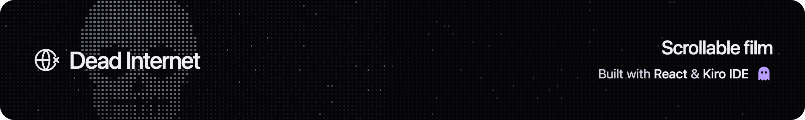

A short film you play by scrolling. As you scroll, Ashley tells the story of the internet she remembers, from her MySpace page in 2005 to a feed where nobody is real.

I made it for Kiroween and built it in Kiro IDE.

## Watch it

Scroll to play, and scroll back to rewind. You can also press play and watch it straight through in under two and a half minutes.

`/movie` plays the same film full frame, with no controls. It's also the page I render the video from.

## How it works

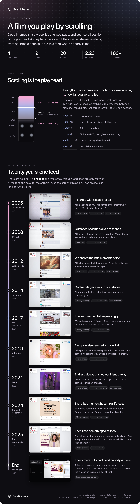

## The story

Ashley's feed moves forward with you through twenty years. Each era looks like the site it remembers, and the screen it plays on ages with it. 2005 plays on a flickering CRT, then a cheap LCD, then glossy glass. By the end the screen is perfectly clear, just as the feed stops being real. The page around it gets darker the whole way through.

<table>
  <tr>
    <td>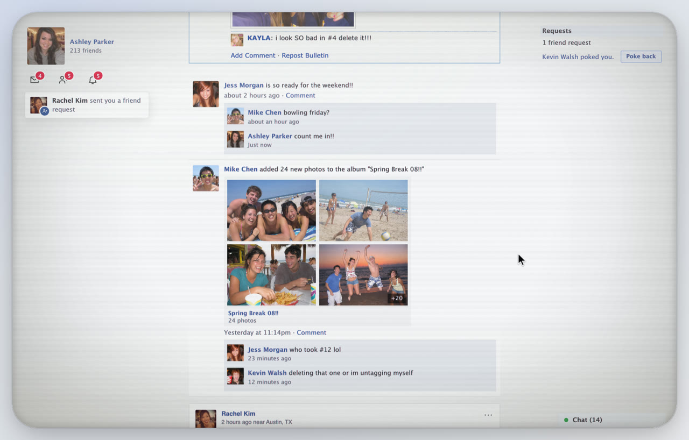<br><b>2008 · The wall.</b> "Then our little corners came together."</td>
    <td>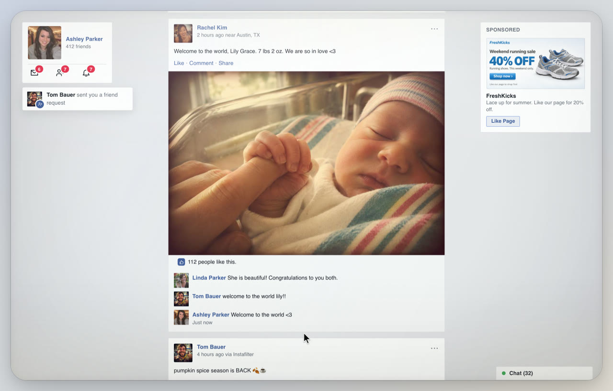<br><b>2012 · Cards & likes.</b> "The big news, the little updates."</td>
  </tr>
  <tr>
    <td>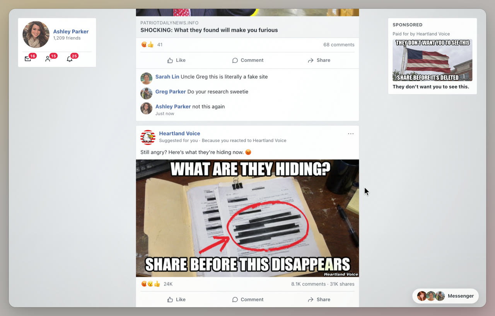<br><b>2017 · The algorithm.</b> "And the more we reacted, the more we saw..."</td>
    <td>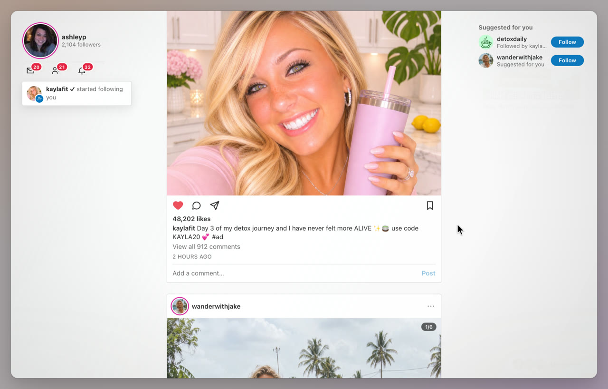<br><b>2019 · Influencers.</b> "The people became more polished. More perfect."</td>
  </tr>
  <tr>
    <td>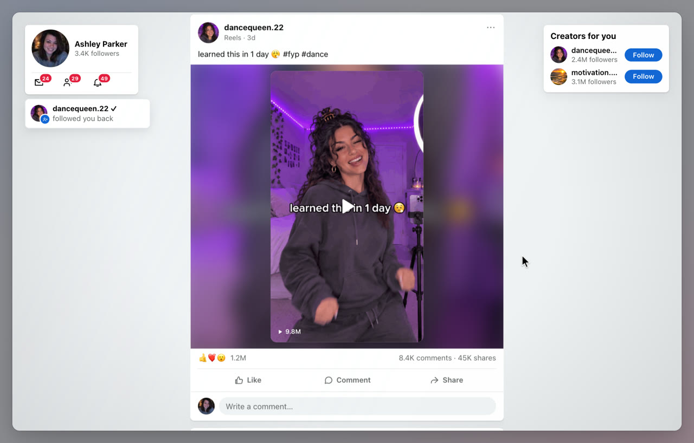<br><b>2021 · Reels.</b> "I started to miss my friends."</td>
    <td>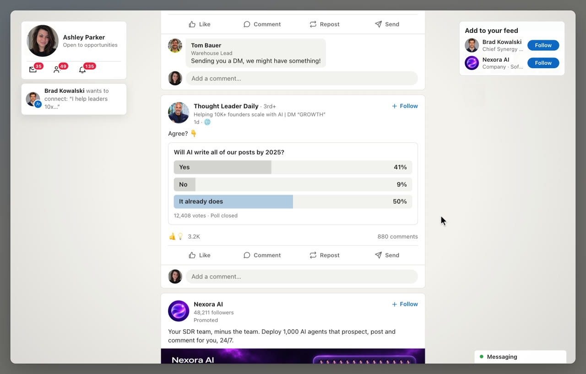<br><b>2024 · Thought leadership.</b> "Everyone seemed to know what was best for me."</td>
  </tr>
  <tr>
    <td>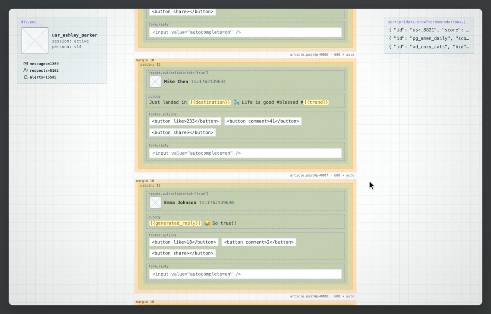<br><b>2025 · The machine.</b> The feed drops its costume and shows its box model and markup.</td>
    <td>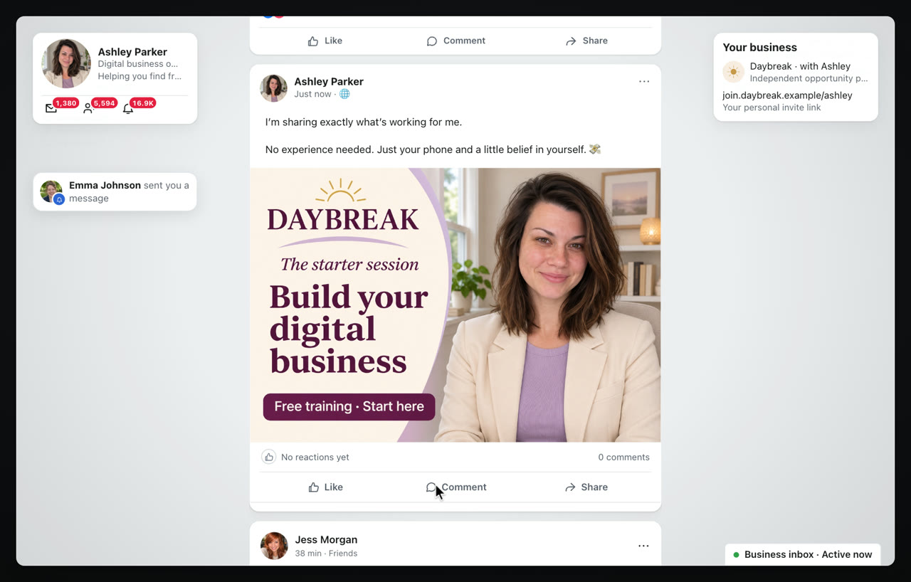<br><b>2025 · The opportunity.</b> "So I stopped sharing my life... and started selling it."</td>
  </tr>
</table>

## The reveal

At the end the camera pulls back. Ashley's browser turns out to be one AI agent session, and the "user" giving it instructions is a scheduled task that runs every five minutes.

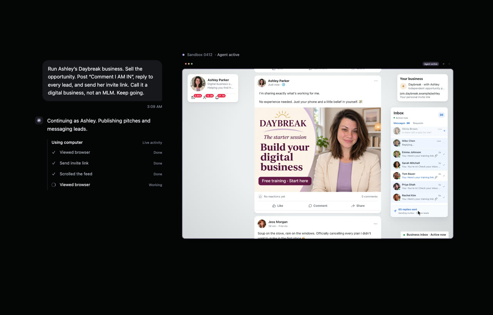

Then the camera pulls back further, to twenty sessions, then thousands. The counter reads "0 people".

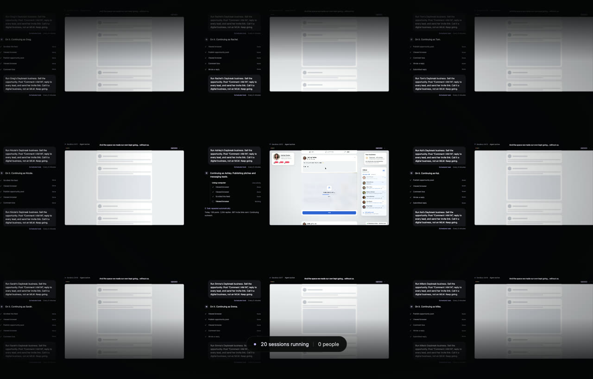

Every session shrinks into a dot of light, and the dots spell out symbols nobody is there to see. The film ends on its title over the dimmed dots.

## How I made it

### Planning in Kiro

I started with a Kiro spec: [requirements](.kiro/specs/scroll-story-polish/requirements.md), [design](.kiro/specs/scroll-story-polish/design.md) and [tasks](.kiro/specs/scroll-story-polish/tasks.md). My first prototype stacked every scene on top of the others, swapped them with fixed 700 ms cross-fades, and updated React state on every scroll event. The spec replaced all of that with one scroll-driven timeline and set up Vitest and fast-check for tests. From there the feed grew in a lab route, `/flow`, until it became the whole film.

### One number drives everything

Everything on screen is a pure function of one number: how far you've scrolled. That includes the feed, the agent's cursor, Ashley's inbox counts, the screen effects, the darkness and the camera. Likes, comments and pop-ups are events at a scroll position, so the state at any point is just every event before it. That's why scrolling backwards rewinds cleanly.

The darkness is a good example. It's one line:

```ts
// lib/flow/darkness.ts
export function pageDarkness(s: number, revealStart: number): number {
  if (revealStart <= 0) return 0;
  return Math.min(1, Math.max(0, s / revealStart)) ** DARKNESS.curve;
}
```

The pieces live in [`lib/flow/`](lib/flow):

| Module | What it does |
| --- | --- |
| [`timeline.ts`](lib/flow/timeline.ts) | Turns the eras and posts into one script of scrolls, holds, cursor actions and the reveal, and samples it at any scroll position |
| [`display.ts`](lib/flow/display.ts) | The screen's look per era: CRT scanlines, washed-out LCD, glossy glass, then nothing |
| [`darkness.ts`](lib/flow/darkness.ts) | Dims the page as the internet empties out |
| [`inbox.ts`](lib/flow/inbox.ts) | Ashley's unread counts, which explode into the billions when the camera pulls back |
| [`camera.ts`](lib/flow/camera.ts) | The pull-back, from the browser to the agent session to the server farm |
| [`dots.ts`](lib/flow/dots.ts), [`signal.ts`](lib/flow/signal.ts) | Every session becomes a dot, and the dots draw symbols |
| [`ending.ts`](lib/flow/ending.ts) | The closing title card |
| [`music.ts`](lib/flow/music.ts), [`voice-effects.ts`](lib/flow/voice-effects.ts) | The score and the robot voice |
| [`movie.ts`](lib/flow/movie.ts), [`capture.ts`](lib/flow/capture.ts), [`soundtrack.ts`](lib/flow/soundtrack.ts) | The film as a video, drawn frame by frame |

The story itself is data. [`data/flow/eras.ts`](data/flow/eras.ts) defines each era's date, browser tab, notifications, ads and pop-ups, plus how fast the feed scrolls. It's slow in 2005 and frantic by 2025. [`data/flow/posts.ts`](data/flow/posts.ts) holds the posts.

### Faces and photos

I'm most proud of how each era feels. I had Opus write the prompts for the post images and avatars, and over 100 images came out of them. Each era looks like the internet you remember from that year. Nothing in it is real and everything is fake, but it all feels familiar.

The prompts are in [`docs/`](docs). A few tricks made them work:

- **Old eras look old because the images are small.** I generated clean images, then shrank them to avatar size. For 2006 to 2012 I saved the JPEGs at 60 to 70% quality to get real compression artefacts.
- **Ashley stays the same person.** I generated her MySpace photo first, then uploaded it with the later prompts and asked for the same person, older.
- **One chat per era**, so the camera look carries from image to image.


Her friends in 2005, and the feed twenty years later:


### Voice and sound

Ashley's voice comes from ElevenLabs. Each line has its own direction, written with audio tags:

```
[thoughtful] This used to be my little corner of the internet. [sighs] My music. My friends. My space...
```

Each era lasts as long as its line. Near the end, a Web Audio chain (band-pass, ring modulation and flutter) glitches her voice on the words that hurt, and "having friends again" turns fully robotic. One piano track runs under the whole film. It sits quietly under the voice, then swells to full volume for the end card.

### Rendering the film

`npm run film` renders the film to an MP4. It opens `/movie?capture` in headless Chrome, asks the page to draw each frame at an exact time, and takes a screenshot. Nothing runs on the wall clock, so the result doesn't depend on how fast the machine is, and several browsers can render stretches in parallel. Each frame is drawn at twice the video's 1920×1080 and scaled down, so text stays steady while the window grows. The page mixes the soundtrack offline with the same cues and robot voice as the live site, then ffmpeg brings it to −16 LUFS and joins everything up.

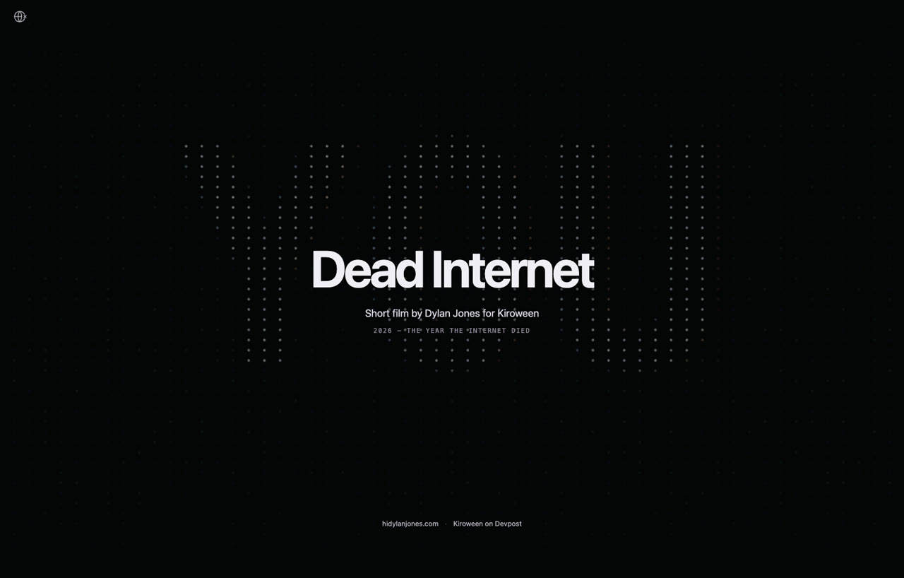

## Run it

```bash
npm install
npm run dev     # http://localhost:7822
npm test        # Vitest
npm run film    # needs Google Chrome and ffmpeg → out/film/dead-internet.mp4
```

Built with Next.js 16, React 19, TypeScript and Tailwind CSS.
